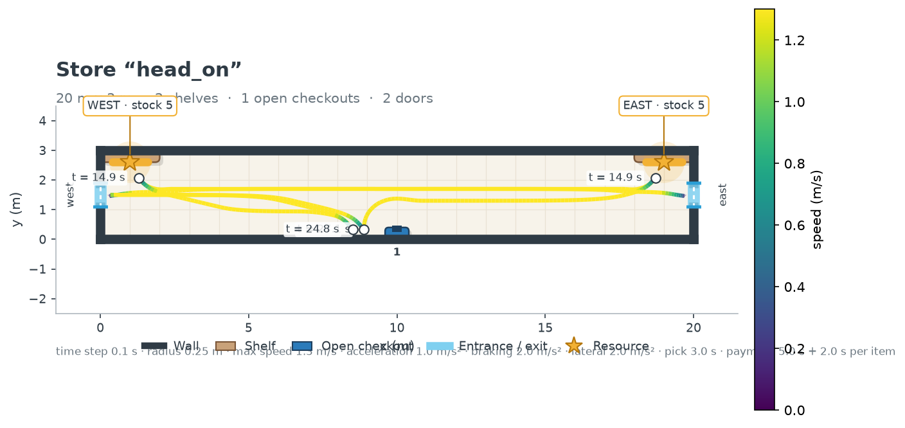
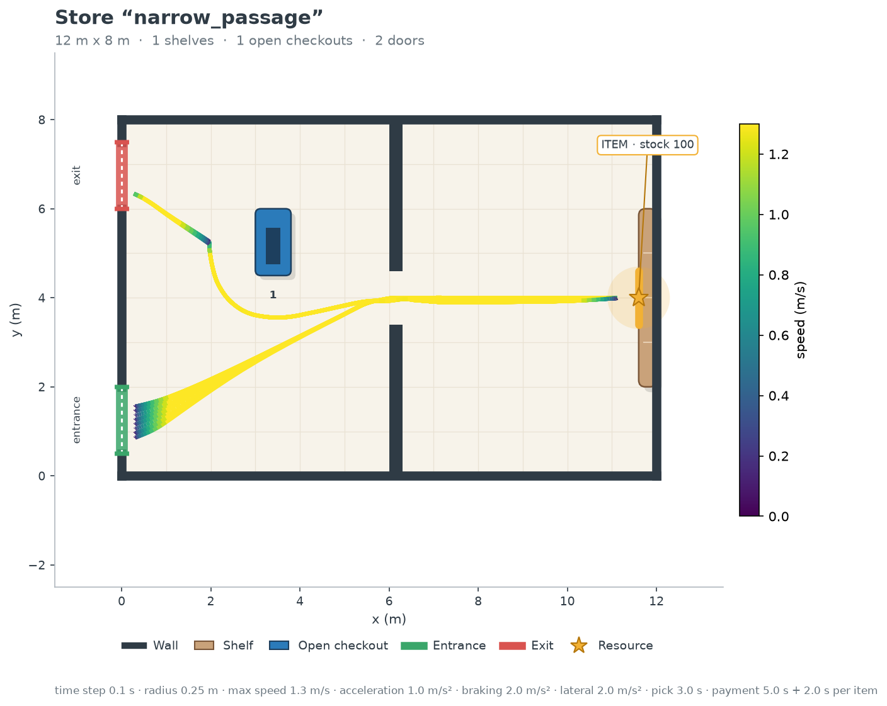
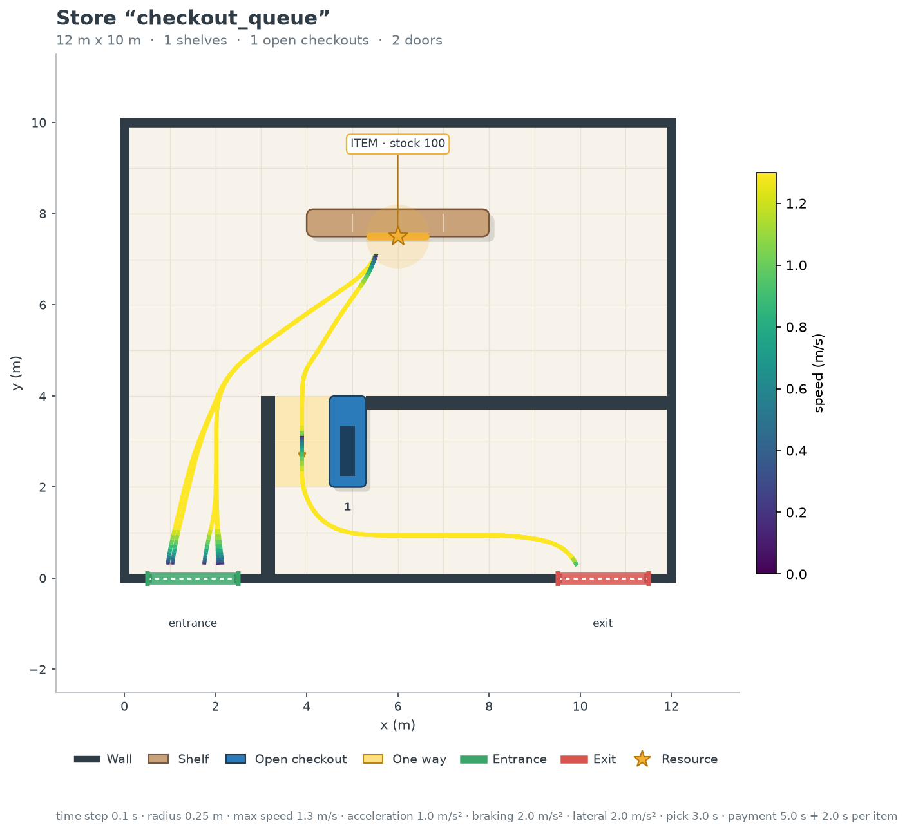

# Configurations de test de M2

Trois petits magasins, dans `configs/tests/`, pour vérifier le modèle M2 (contacts et file
d'attente) sur des cas simples où l'on sait ce qui doit se passer. Ils utilisent les mêmes
paramètres de client que la référence (rayon 0,25 m, vitesse maximale 1,3 m/s, pas de
temps 0,1 s).

Pour les lancer :

```powershell
.venv\Scripts\python run.py configs/tests/head_on.json --simulate --output outputs/tests/head_on.png
.venv\Scripts\python check_paths.py configs/tests/head_on.json
```

Les trois configurations passent `check_paths.py` (0 client bloqué, 0 pénétration,
0 contresens) et tous les clients sortent.

## Deux clients face à face : `head_on.json`



- Couloir de 20 m × 3 m, une porte d'entrée et de sortie à chaque bout (0,8 m de large).
- Un produit à chaque bout (`WEST` et `EAST`), une caisse au milieu contre le mur du bas.
- `client_west` entre par l'ouest et veut `EAST` ; `client_east` entre par l'est et veut
  `WEST`. Ils partent tous les deux à t = 0.

Avec M1 (aujourd'hui), ils se croisent exactement de face : à t = 8,1 s, au milieu du couloir
(x = 10 m, y = 1,7 m), avec un angle de 180° entre leurs directions, et se traversent.

**Attendu en M2 :** les deux clients se bloquent sans se traverser. On mesure le
chevauchement maximal restant (il doit rester très petit devant le rayon), puis on regarde
s'ils arrivent à se contourner (le couloir fait 3 m, il y a la place).

## Passage étroit : `narrow_passage.json`



- Magasin de 12 m × 8 m coupé en deux par un mur, avec une seule ouverture de 1,2 m.
- L'entrée, la sortie et la caisse sont à gauche, le produit (`ITEM`, stock 100) est à
  droite : chaque client passe deux fois l'ouverture, à l'aller et au retour.
- 20 clients, un toutes les 2 s.

Avec les obstacles en boules, le centre d'un client ne dispose que d'environ 0,55 m de large dans
l'ouverture : deux clients ne peuvent pas y passer de front. Avec M1, tous passent sur la
même ligne (y ≈ 4 m) dans les deux sens.

**Attendu en M2 :** pas de chevauchement dans l'ouverture, une attente de part et d'autre
quand un client arrive en face, et des contacts concentrés autour de l'ouverture. C'est aussi
le cas le plus simple pour tester la compatibilité de la correction des positions avec les
murs (sous-étape 2.3). La largeur de l'ouverture se change avec `duplicate_config` (déplacer
`wall_high`) pour l'étude de la largeur des allées.

## Caisse avec plusieurs clients : `checkout_queue.json`



- Magasin de 12 m × 10 m sur le modèle de la référence : un mur à droite de l'entrée, une
  seule caisse ouverte avec son allée à sens unique vers le bas, un mur qui oblige à passer
  par la caisse pour sortir.
- Le produit est en face de la caisse : les clients arrivent en caisse presque ensemble.
- 6 clients, un par seconde (`client_1` à `client_6`, arrivées de 0 à 5 s). Un paiement dure
  5 s + 2 s par article, soit 7 s.

Avec M1, les 6 clients paient en même temps au même endroit (ils sortent tous 28 s après
leur entrée), ce qui est impossible en vrai.

**Attendu en M2 :** un seul client servi à la fois, les autres attendent l'un derrière
l'autre dans l'allée de la caisse et avancent d'une place à chaque client servi. L'ordre de
passage doit être `client_1` à `client_6`. Le dernier client arrive environ 5 s après le
premier et doit attendre 5 paiements de 7 s : il attend donc environ 30 s avant son tour. C'est la configuration à utiliser pour les sous-étapes 2.5
et 2.7.
