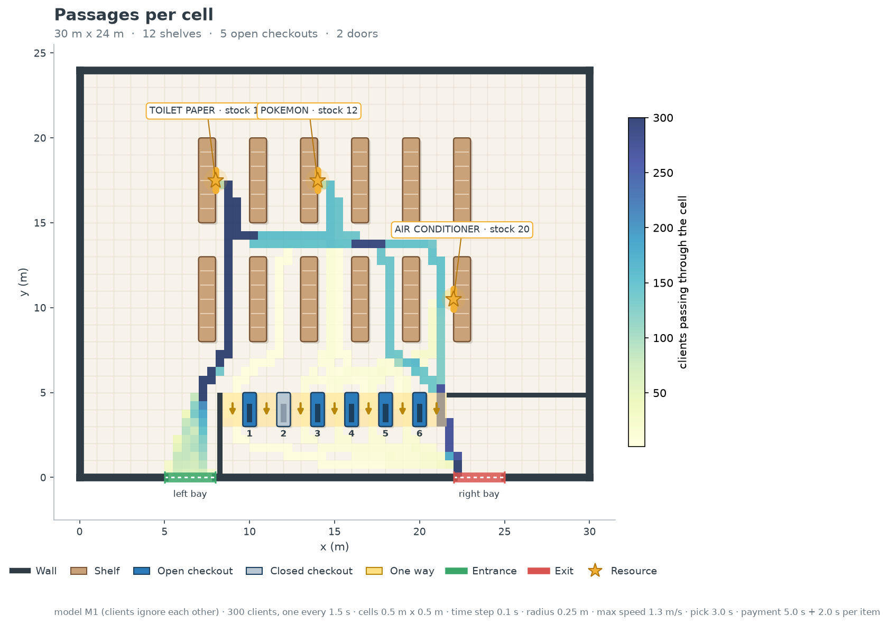
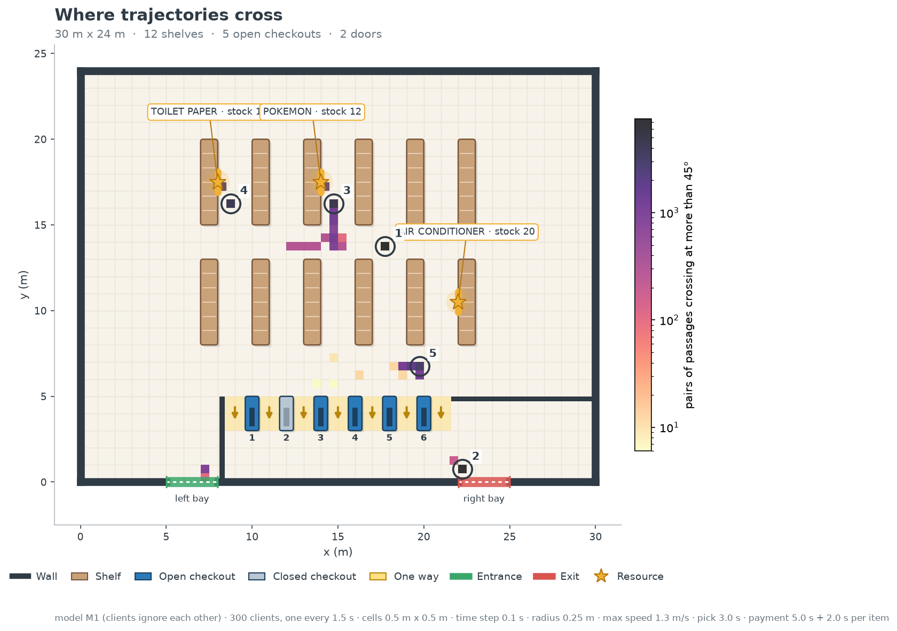
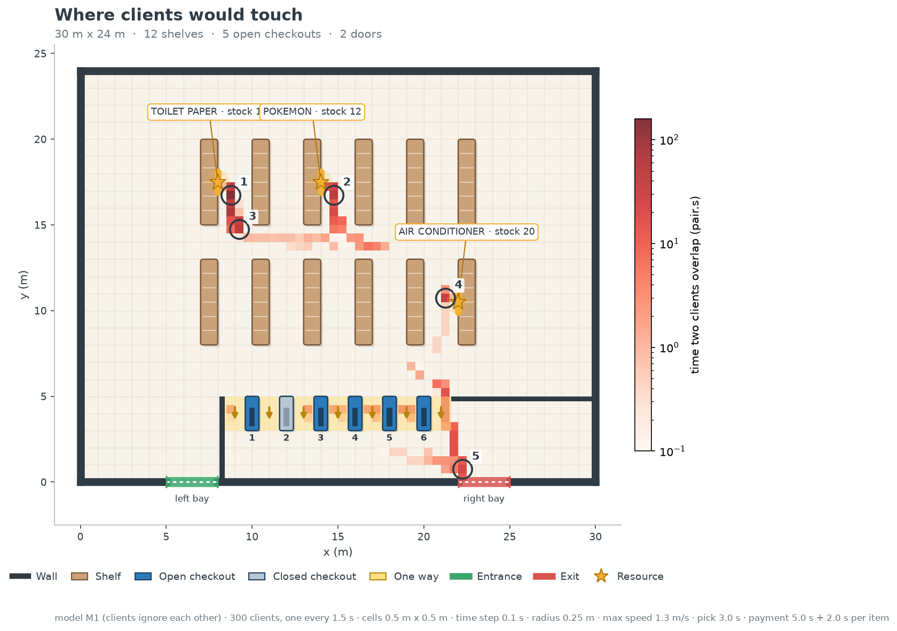

# Vérification du modèle M1

Résultats de la vérification de M1 (des clients qui s'ignorent), à reprendre dans la partie
« Validation » du rapport. Mesures faites le 10 novembre 2026 sur le commit `91ecddb`, avec
la configuration de référence (`configs/reference.json`).

Rappel du cahier des charges : *chaque client atteint son objectif quelle que soit sa position
de départ, sans jamais entrer dans un rayon. On observe déjà les endroits où les trajets se
croisent, donc où les contacts auront lieu.*

## 1. Chaque client atteint son objectif

Commande (script de Thomas, sous-étape 1.1) :

```powershell
.venv\Scripts\python check_paths.py configs/reference.json
```

Méthode : un client est lancé vers chaque objectif (les 3 produits, les 5 caisses ouvertes et
la sortie) depuis 4 159 positions de départ, avec une direction initiale tirée au hasard :

- une grille régulière d'un point par mètre carré ;
- 4 000 points tirés au hasard dans le magasin ;
- 4 000 points tirés juste au bord des obstacles (entre 0 et 3 cm de la distance minimale),
  là où le client a le plus de risques d'entrer dans un rayon.

Les départs à l'intérieur d'un obstacle sont retirés. Un trajet échoue si le client n'est pas
arrivé au bout de 300 s simulées.

| Mesure                                          | Résultat     | Attendu |
| ----------------------------------------------- | ------------ | ------- |
| Trajets lancés                                  | 37 431       |         |
| Trajets arrivés                                 | 33 010       |         |
| Trajets sans chemin possible (voir ci-dessous)  | 4 421        |         |
| Clients bloqués (non arrivés en 300 s)          | **0**        | 0       |
| Pénétration maximale dans un obstacle           | **0,0000 m** | 0       |
| Départs sans chemin vers la sortie              | **0**        | 0       |
| Pas à contresens dans une allée à sens unique   | **0**        | 0       |

Les 4 421 trajets sans chemin ne sont pas des échecs. Ils partent tous de la zone située
après les caisses (y < 5 m, x > 8,4 m) : les allées des caisses sont à sens unique vers le
bas, donc un client qui s'y trouve ne peut plus remonter vers les produits ou vers une autre
caisse. Il peut seulement sortir, et la sortie est atteinte depuis tous les départs. On a
vérifié que les 557 départs sans chemin vers un produit sont tous dans cette zone (et les
551 départs sans chemin vers la caisse 1 aussi).

Le même contrôle passe sur les trois configurations de test de M2 (voir
[`configs_test.md`](configs_test.md)) : 0 client bloqué, 0 pénétration, 0 contresens.

**Conclusion :** la vérification de M1 est remplie. Depuis n'importe quelle position, le
client atteint son objectif sans entrer dans un rayon ni prendre une allée à contresens.

## 2. Les endroits où les trajets se croisent

Commande (sous-étape 1.2) :

```powershell
.venv\Scripts\python passage_zones.py configs/reference.json --output outputs/passage_zones.png
```

Le script simule les 300 clients de la référence (un toutes les 1,5 s) avec le modèle M1 :
les clients ne se voient pas et peuvent se superposer. Le magasin est découpé en cases de
0,5 m × 0,5 m et le script produit trois figures (copiées dans [`figures/`](figures/)).

| Figure                          | Ce qui est compté dans chaque case |
| ------------------------------- | ----------------------------------------------------------------------------------- |
| `passage_zones_passages.png`    | Nombre de clients différents qui traversent la case. |
| `passage_zones_crossings.png`   | Nombre de paires de passages dont les directions font plus de 45°. Chaque passage est classé dans un secteur de 22,5° selon sa direction moyenne dans la case. Les 5 zones les plus fortes sont numérotées. |
| `passage_zones_overlaps.png`    | Temps pendant lequel deux clients se superposent (distance entre centres < 2 × 0,25 m), compté au milieu des deux clients, en paire·s. Les 5 zones les plus fortes sont numérotées. |

La troisième figure est la plus directe : dans M2, les clients ne pourront plus se
superposer, donc ces superpositions deviendront des contacts.





### Résultats chiffrés

- 300 clients entrés, 300 sortis, en 488,8 s.
- 964 paires de clients se superposent au moins une fois.
- Durée totale de superposition : 930,4 paire·s, répartie selon l'angle entre les deux
  directions :

| Type de rencontre                  | Durée (paire·s) | Part |
| ---------------------------------- | --------------- | ---- |
| Face à face (plus de 135°)         | 463,0           | 50 % |
| Même sens (moins de 45°)           | 235,7           | 25 % |
| L'un des deux est arrêté           | 222,8           | 24 % |
| Croisement (entre 45° et 135°)     | 8,9             | 1 %  |

Zones de superposition les plus fortes :

| Rang | Case (centre)  | Élément le plus proche     | Durée (paire·s) |
| ---- | -------------- | -------------------------- | --------------- |
| 1    | (8,75 ; 16,75) | Rayon du papier toilette   | 158,9           |
| 2    | (14,75 ; 16,75)| Rayon des Pokémon          | 48,8            |
| 3    | (9,25 ; 14,75) | Allée du papier toilette   | 45,1            |
| 4    | (21,25 ; 10,75)| Rayon des climatiseurs     | 36,7            |
| 5    | (22,25 ; 0,75) | Porte de sortie            | 22,3            |

### Ce qu'on observe

- **Tous les clients prennent le même couloir.** Les 300 clients montent par l'allée
  x ≈ 9 m jusqu'au papier toilette, car c'est le plus court chemin depuis l'entrée. Ce
  couloir a la largeur d'un seul client et il est emprunté dans les deux sens (aller vers
  le papier toilette, retour vers les autres produits) : c'est la cause des 50 % de
  rencontres face à face.
- **Les produits sont les points chauds.** Les trois premières zones sont autour du papier
  toilette et des Pokémon : les clients s'y arrêtent 3 s pour prendre le produit pendant que
  les suivants arrivent et que d'autres repartent.
- **La sortie concentre les flux.** Le stock étant limité (42 produits pour 300 clients),
  la plupart des clients repartent sans rien et passent tous par l'allée sans achat
  (x ≈ 21 m) puis par la porte de sortie.
- **Les vrais croisements (45° à 135°) sont rares** (1 %) : les trajets suivent les allées,
  donc les clients se rencontrent surtout de face ou en se suivant, pas en se coupant.

Ces zones sont celles où il faudra regarder les contacts dans M2, et elles orientent déjà la
problématique : la largeur des allées et la position de la ressource jouent directement sur
les zones 1 à 4.

### Limites de la mesure

- Dans M1, les clients ne se gênent pas et prennent tous exactement le même chemin. Dans M2,
  ils s'écarteront et ralentiront : les zones resteront les mêmes, mais les durées vont
  changer.
- Les caisses ne servent pas encore un client à la fois (la file d'attente arrive en M2) :
  plusieurs clients paient en même temps au même endroit, ce qui est compté comme des
  superpositions « l'un des deux est arrêté ».
- Le résultat dépend de la taille des cases (0,5 m) et d'une seule simulation (graine 1).
